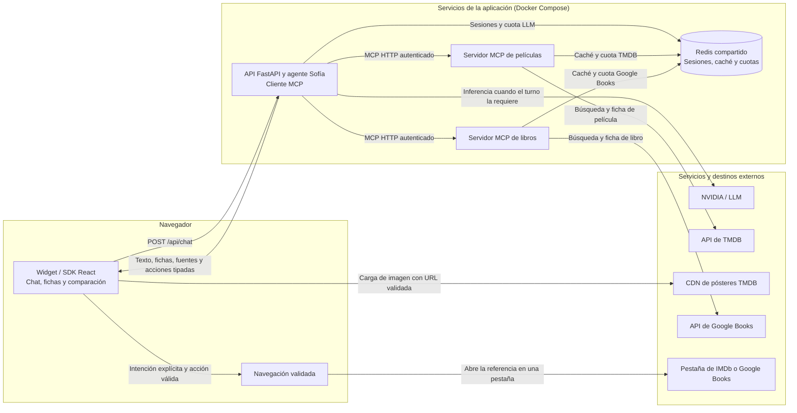
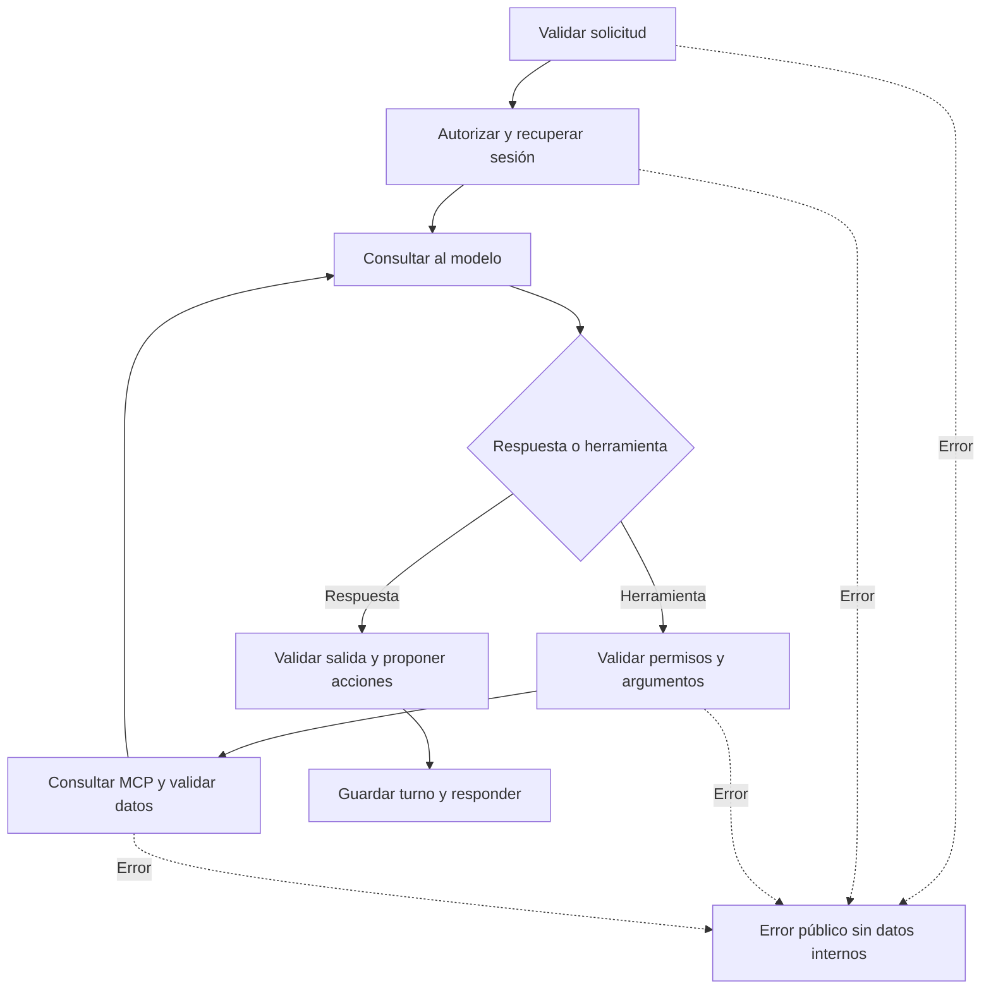

# Arquitectura de AGIChat / Sofía

Arquitectura implementada para la segunda entrega de AGIChat. El widget y el SDK
React de la primera entrega conservan su estado en Zustand y se conectan a Sofía
mediante la API HTTP.

## Alto nivel

En modo real, el navegador envía los turnos a FastAPI; en desarrollo Vite
redirige `/api` al backend local. Las credenciales de NVIDIA, TMDB, Google Books
y MCP quedan en servidor. El navegador solo accede a los recursos públicos
validados para mostrar pósteres y abrir referencias. El modo demo usa MSW y no
forma parte del recorrido real representado arriba.

Sofía es el único agente. Los dos servidores MCP exponen herramientas de consulta
reutilizables. El de películas obtiene el catálogo de TMDB; el de libros aporta
datos de Google Books y evidencia de adaptación para que Sofía pueda comparar
cuando el vínculo está sustentado. IMDb es un destino de referencia cuyo enlace
se obtiene a partir del identificador externo de TMDB.

## Bajo nivel: agente centralizado

La clasificación es **centralizada con un agente**. Los servidores MCP son
herramientas, no agentes. No se usa A2A ni se afirma un MAS. El ciclo tiene un
máximo configurable que por defecto es de cuatro solicitudes LLM, seis
invocaciones MCP y 60 segundos por turno. En el ciclo con herramientas, la
última consulta al modelo solicita una respuesta final sin herramientas.

Las instrucciones viven en servidor. Usuario, historial y resultados MCP cruzan
fronteras de confianza como datos. El modelo no puede registrar herramientas,
elegir endpoints ni ejecutar código. El backend valida argumentos, resultados,
IDs obtenidos del catálogo y URLs de proveedores antes de entregarlos al cliente.

La navegación requiere intención explícita del mensaje actual y una referencia
verificada. El agente devuelve `open_reference`; el widget valida y deduplica la
acción antes de navegar en la pestaña reservada al enviar el mensaje. Si el
navegador la bloquea, el widget ofrece un enlace de respaldo validado.
Renderizar texto o restaurar historial no autoriza acciones.

## Decisiones y alternativas

| Decisión                 | Alternativas consideradas                 | Motivo y límite                                                          |
| ------------------------ | ----------------------------------------- | ------------------------------------------------------------------------ |
| Un agente con MCP        | Flujo fijo; supervisor con varios agentes | Flexibilidad conversacional con menos llamadas y controles centralizados |
| Python y FastAPI         | Backend TypeScript                        | Reutilizar experiencia MCP del equipo; contratos JSON neutrales          |
| Ciclo explícito          | Framework de agentes                      | Mantener visibles autorización, pasos, errores y presupuesto             |
| Redis compartido         | Diccionario; SQLite                       | Expiración y coordinación entre procesos; requiere operar un servicio    |
| Compose para servicios   | Solo Redis; incluir también el frontend   | Inicia API, MCP y Redis juntos; el frontend se ejecuta por separado      |
| Respuestas sin streaming | Streaming                                 | Menor complejidad y compatibilidad con `{ response }`                    |

Modelo inicial: Nemotron 3.5 Lightning 30B-A3B. Alternativa manual: Nemotron 3.5
Super VL 120B-A12B. Ambos se eligieron del catálogo con endpoint gratuito;
disponibilidad/cuotas deben verificarse antes de nuevas pruebas. No existe
fallback automático ni registro de pagos. La clave se inyecta al arrancar y no
se copia a la imagen. Ver [implementación M1](../delivery/implementacion-m1.md).

## Estado, concurrencia y escalabilidad

El backend no conserva conversaciones productivas en memoria local. Redis guarda
historial acotado, contexto de catálogo, hash de credencial y últimas 20 respuestas
deduplicadas por sesión. Una credencial opaca separada del ID autoriza acceso.
Expiración por inactividad: 30 minutos; borrado explícito desde API disponible.

Una reserva por sesión con vencimiento impide ejecutar dos turnos simultáneos.
Guardar resultado requiere conservar la propiedad de la reserva, mediante Lua
atómico. Una respuesta ya completada puede repetirse con los mismos IDs de acción;
el widget deduplica efectos en el navegador. No hay garantía exactly-once de consultas
externas frente a caída de proceso. Las herramientas son de consulta.

Distintas sesiones pueden procesarse en réplicas del backend con el mismo Redis.
El contador diario LLM también es compartido y atómico; cuenta intentos, incluidas
pruebas reales y fallos. El presupuesto del curso es 1.000 solicitudes diarias
configurables, con reinicio UTC; no es una cuota contractual atribuida a NVIDIA.
Los servidores MCP HTTP no conservan sesiones propias. Comparten en Redis caché
y contadores, separados por proveedor. Así, agregar réplicas permite atender más
solicitudes concurrentes sin duplicar el presupuesto; los aciertos de caché no
consumen cuota de TMDB ni de Google Books.

**Docker facilita reproducibilidad; no garantiza escala por sí mismo.** Redis
único, cuotas externas y latencia del LLM limitan el rendimiento. El volumen local
y AOF no proporcionan alta disponibilidad entre hosts. La
[medición de M2](../evidence/m2/benchmark.json) registró 40 solicitudes con
concurrencia de 8, 5 llamadas al proveedor simulado, 0 errores y p95 de 58.975 ms.
Usó Redis real y dos clientes de caché en un proceso. Una
[prueba separada](../delivery/implementacion-m2.md#verificación-ejecutada)
verificó la cuota compartida entre dos procesos. Estas pruebas no miden
capacidad de producción ni rendimiento de los proveedores reales.

## Evidencia y pendientes

- [Operación local](../../infra/README.md): API, MCP, Redis y frontend en modo real.
- [Evidencia M4 en Chromium](../branches/feat/m4-widget-ux/06-navegacion-referencias.md):
  SDK compilado, póster y comparación con catálogos reales y apertura de ambas
  referencias. Las acciones de ese recorrido se generan en una ruta determinista.
- [Evals de M3](../evidence/m3/README.md): los reportes separan los casos
  controlados de LLM01/LLM07 de la evaluación funcional con servicios reales.
  Ese registro no acredita corridas adversariales repetidas contra NVIDIA real.
