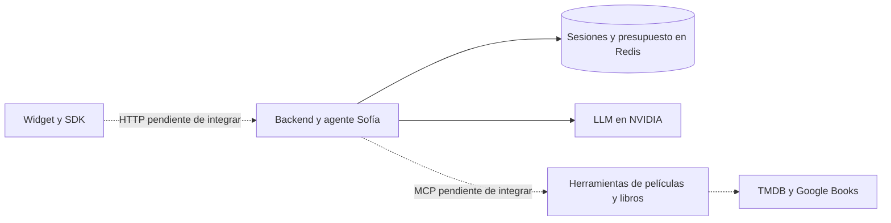
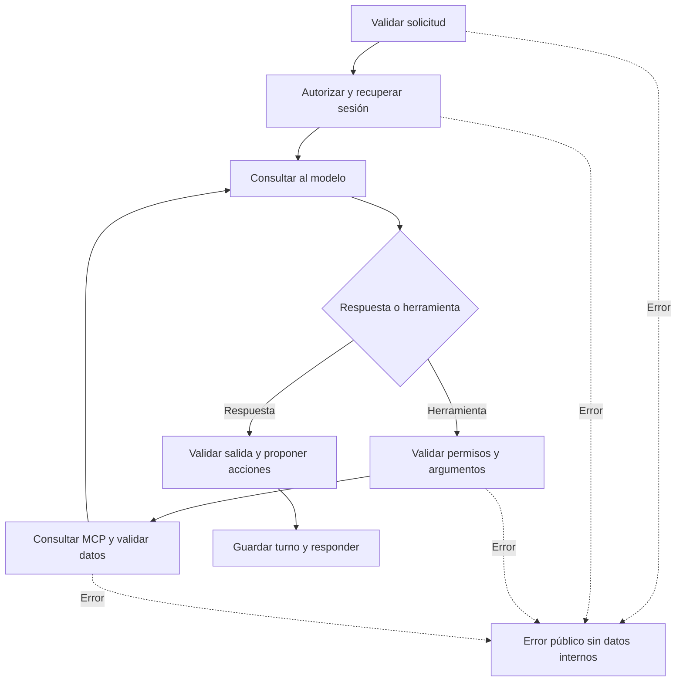

# Arquitectura de AGIChat / Sofía

Actualización de M1: 15 de noviembre de 2026. Las vistas separan responsabilidades
y omiten componentes visuales, clases y archivos. La primera entrega conserva su
widget/SDK React, estado Zustand y servicio HTTP; la segunda añade el backend.

## Alto nivel

Las líneas discontinuas indican integración de producto pendiente. Están
implementados backend, adaptadores, cliente MCP y almacenamiento Redis. Se probó
NVIDIA real con una herramienta sintética y MCP HTTP real contra un servidor
sintético; **no se verificó aún el recorrido widget → TMDB/libros reales**.

El navegador llama únicamente al backend; no recibe credenciales de proveedores.
M2/M3 implementan servidores MCP reutilizables desde clientes independientes.
Mostrar un póster utiliza su URL TMDB validada: no requiere un modelo de visión.

## Bajo nivel: agente centralizado

La clasificación es **centralizada con un agente**. Los servidores MCP son
herramientas, no agentes. No se usa A2A ni se afirma un MAS. El ciclo tiene un
máximo de cuatro solicitudes LLM, seis invocaciones MCP y 60 segundos por turno;
la última consulta al modelo solicita respuesta final sin herramientas.

Las instrucciones viven en servidor. Usuario, historial y resultados MCP cruzan
fronteras de confianza como datos. El modelo no puede registrar herramientas,
elegir endpoints ni ejecutar código. El backend valida argumentos, resultados,
IDs obtenidos del catálogo y URLs de proveedores antes de entregarlos al cliente.

La navegación requiere intención explícita del mensaje actual y una referencia
verificada. El agente devuelve `open_reference`; el navegador de M4 validará,
deduplicará y abrirá la pestaña. Renderizar texto o restaurar historial no autoriza
acciones. La apertura real y el bloqueo de popups siguen pendientes de M4.

## Decisiones y alternativas

| Decisión                 | Alternativas consideradas                 | Motivo y límite                                                          |
| ------------------------ | ----------------------------------------- | ------------------------------------------------------------------------ |
| Un agente con MCP        | Flujo fijo; supervisor con varios agentes | Flexibilidad conversacional con menos llamadas y controles centralizados |
| Python y FastAPI         | Backend TypeScript                        | Reutilizar experiencia MCP del equipo; contratos JSON neutrales          |
| Ciclo explícito          | Framework de agentes                      | Mantener visibles autorización, pasos, errores y presupuesto             |
| Redis compartido         | Diccionario; SQLite                       | Expiración y coordinación entre procesos; requiere operar un servicio    |
| Compose backend + Redis  | Solo Redis; producto entero               | M1 puede ejecutarse; M2 integra MCP y frontend                           |
| Respuestas sin streaming | Streaming                                 | Menor complejidad y compatibilidad con `{ response }`                    |

Modelo inicial: Nemotron 3.5 Lightning 30B-A3B. Alternativa manual: Nemotron 3.5
Super VL 120B-A12B. Ambos se eligieron del catálogo con endpoint gratuito;
disponibilidad/cuotas deben verificarse antes de nuevas pruebas. No existe
fallback automático ni registro de pagos. La clave se inyecta al arrancar y no
se copia a la imagen. Ver [implementación M1](../delivery/implementacion-m1.md).

## Estado, concurrencia y escalabilidad

El backend no conserva conversaciones productivas en memoria local. Redis guarda
historial acotado, contexto de catálogo, hash de credencial y últimas 20 respuestas
deduplicadas por sesión. Una credencial opaca separada del ID autoriza acceso.
Expiración por inactividad: 30 minutos; borrado explícito desde API disponible.

Una reserva por sesión con vencimiento impide ejecutar dos turnos simultáneos.
Guardar resultado requiere conservar la propiedad de la reserva, mediante Lua
atómico. Una respuesta ya completada puede repetirse con los mismos IDs de acción;
M4 debe deduplicar efectos en navegador. No hay garantía exactly-once de consultas
externas frente a caída de proceso. Las herramientas son de consulta.

Distintas sesiones pueden procesarse en réplicas del backend con el mismo Redis.
El contador diario LLM también es compartido y atómico; cuenta intentos, incluidas
pruebas reales y fallos. El presupuesto del curso es 1.000 solicitudes diarias
configurables, con reinicio UTC; no es una cuota contractual atribuida a NVIDIA.
Caché y presupuestos TMDB/Books son responsabilidad de M2/M3 y siguen pendientes.

**Docker facilita reproducibilidad; no garantiza escala por sí mismo.** Redis
único, cuotas externas y latencia del LLM limitan el rendimiento. El volumen local
y AOF no proporcionan alta disponibilidad entre hosts. M2 debe definir operación
de Redis compartido, recuperación y ensayo de carga con p50/p95 y errores antes
de afirmar capacidad de producción. Las pruebas actuales verifican aislamiento,
exclusión y contadores entre dos instancias, no capacidad ilimitada ni HA.

## Evidencia y pendientes

Código y pruebas se ejecutan con [los comandos de M1](../../server/README.md). Se exige
≥80% por archivo en las cuatro métricas, sin ocultar scripts o entrypoints. Evals
reales funcionales, LLM01/LLM07, CI global y aceptación de contratos por consumidores
siguen pendientes de integración; tests con dobles no los sustituyen.
