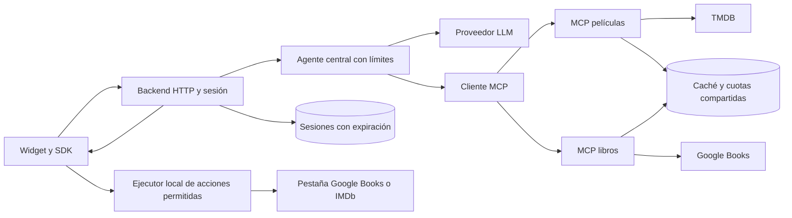

# Plan de la segunda entrega: Sofía recomienda cine y libros

## Contexto y diagnóstico del repositorio

Revisión del 15 de noviembre de 2026. Fuente académica: [INSTRUCTIONS.md](../../INSTRUCTIONS.md). Reglas obligatorias: [AGENTS.md](../../AGENTS.md). Diseño común: [DESIGN.md](../../DESIGN.md). La [rúbrica y el material del curso](contexto-curso-rubrica.md) complementan la trazabilidad; el [análisis A2A](reutilizacion-a2a.md) orienta la reutilización de MCP/agente; el [análisis de HDT6](reutilizacion-evals.md) concreta la base del harness de evals.

Existe un frontend React 18/TypeScript con widget, Markdown, SDK configurable, Zustand persistido, MSW, tests y CI. `HttpChatService` ya envía `POST /api/chat` con `{ prompt }` y valida `{ response }`. `ChatInput` orquesta hoy la llamada. El store persiste mensajes, pero no contiene aún una sesión de backend. MSW se activa automáticamente en desarrollo en `src/main.tsx`. No hay backend, integración LLM, MCP ni evals. El script `test:e2e` usa JSDOM. `docs/architecture/ARQUITECTURA.md` documenta la fase 1 y contiene nombres/flujo conceptuales que deben reconciliarse con el código final.

Este cambio entrega instrucciones y planificación; no implementa esas piezas ni acredita que las pruebas del producto pasen.

Actualización posterior de M1 (15/11/2026): el diagnóstico anterior describe el
punto de partida. Ahora existen backend Python, contratos JSON, sesiones Redis,
adaptadores y pruebas. La integración de producto con M2/M3/M4 sigue pendiente;
ver [decisiones y evidencia](implementacion-m1.md) y la
[arquitectura simplificada actualizada](../architecture/ARQUITECTURA.md).

## Reparto equilibrado

Estimación relativa inicial: **16 puntos por miembro**, en cuatro paquetes de trabajo. Los puntos miden esfuerzo/incertidumbre, no horas ni calificación. Incluyen implementación, pruebas y documentación. Revisar el reparto tras el primer flujo integrado; si una restricción de proveedor/navegador cambia el esfuerzo, transferir una tarea concreta, no cargar toda la integración a una persona.

| Miembro | Responsable propuesto | Paquetes y puntos                                                                                                                         | Total |
| ------- | --------------------- | ----------------------------------------------------------------------------------------------------------------------------------------- | ----- |
| 1       | Diego Calderón        | Contratos y sesión (3); backend HTTP (4); agente/orquestación y comparación final (5); defensas y arquitectura (4)                        | 16    |
| 2       | Hugo Méndez           | MCP TMDB (5); catálogo/póster/IMDb (3); cuotas/caché/fallos (4); infraestructura, CI y operación (4)                                      | 16    |
| 3       | Pedro Caso            | MCP Google Books (4); relación adaptación/libro (4); evidencias comparativas (3); harness de evals y reporte (5)                          | 16    |
| 4       | Arodi Chávez          | Cliente/store/SDK (4); recomendaciones y comparación accesibles (4); apertura de referencias en navegador (5); demo, atribución y E2E (3) | 16    |

Nombres tomados del README; Diego asume la parte 1, Hugo la parte 2 y Pedro la parte 3 por asignación del equipo. Pueden intercambiar responsables completos manteniendo los límites. Cada responsable escribe sus tests y casos de eval; el miembro 3 construye el harness, no todas las pruebas del grupo. Revisión cruzada sugerida: 1 ↔ 4 para contrato/seguridad del cliente y 2 ↔ 3 para MCP/proveedores; nadie aprueba su propio PR.

## Arquitectura objetivo propuesta

Un solo agente central es suficiente como punto de partida. Los MCP son servicios de herramientas, no agentes especializados. La clasificación inicial es orquestación centralizada; no describirla como MAS si no hay varios agentes. La rúbrica aportada exige ambos diagramas: alto nivel y bajo nivel de organización/flujo del agente, incluso si hay uno solo. Indicar la clasificación y justificar si se usa MAS; no omitir el segundo diagrama por la condición del enunciado.

Tras revisar el repo A2A del equipo, se recomienda probar primero backend/MCP Python para aprovechar FastMCP y patrones del turno/evals, conservando frontend TypeScript. El contrato debe ser neutral al lenguaje (schemas JSON + fixtures y tipos/adaptadores). M1/M2 confirman Python o TypeScript en el hito 0 con una prueba mínima, documentación oficial, cobertura, disponibilidad sin tarjeta y límites; registrar decisión y comandos. Ver [análisis de reutilización](reutilizacion-a2a.md). No imponer Kubernetes, varios agentes o un framework adicional sin evidencia de necesidad.

### Propiedad de archivos

| Responsable | Archivos actuales                                                                                                                                  | Rutas nuevas propuestas                                           |
| ----------- | -------------------------------------------------------------------------------------------------------------------------------------------------- | ----------------------------------------------------------------- |
| 1           | `docs/architecture/ARQUITECTURA.md`                                                                                                                | `server/`, `shared/contracts/`, tests correspondientes            |
| 2           | `.github/`, configs raíz y scripts, `README.md` operativo                                                                                          | `mcp/movies/`, `infra/`, `.env.example`, pruebas correspondientes |
| 3           | Sin propietario exclusivo previo que conservar                                                                                                     | `mcp/books/`, `evals/`, pruebas correspondientes                  |
| 4           | `src/services/`, `src/store/`, `src/components/`, `src/hooks/`, `src/sdk/`, `src/demo/`, `src/mocks/`, CSS, Tailwind, tests frontend y `DESIGN.md` | Tests de navegador real y recursos oficiales de atribución        |

`package.json`, lockfile y configuraciones raíz los integra el miembro 2. Los demás proponen sus cambios en coordinación para evitar cuatro versiones incompatibles. Miembro 1 publica el contrato; cualquier consumidor puede proponer una revisión antes de depender de ella. No crear todo el árbol vacío de antemano.

## Contrato de integración que se debe cerrar primero (M1 + todos)

Guardar versión inicial, schemas y fixtures válidos/erróneos en `shared/contracts/`, con instrucciones de consumo desde frontend, backend y MCP. Los nombres siguientes son orientativos hasta su revisión conjunta:

| Frontera             | Acuerdo mínimo                                                                                                                                                                                                               |
| -------------------- | ---------------------------------------------------------------------------------------------------------------------------------------------------------------------------------------------------------------------------- |
| HTTP entrada         | `POST /api/chat`, conserva `prompt`; extensión opcional `sessionId`, `requestId` e intención de navegación. Definir límites, autenticación/aislamiento y quién genera cada ID. No aceptar system messages del cliente.       |
| HTTP salida          | Conserva `response: string`; opcionales `sessionId`, `requestId`, `movies`, `comparison`, `sources`, `actions`. Definir estados HTTP y error `{ code, message, retryable, requestId }` sin detalles internos.                |
| Película             | ID TMDB, título, año si existe, sinopsis, póster nullable, referencias TMDB/IMDb verificadas. No inventar IDs o imágenes ausentes.                                                                                           |
| Libro y vínculo      | ID/URL Google Books, título, autor, año si existe, evidencia y estado de vínculo `confirmed`, `uncertain` o `not_found`; distinguir fallo del proveedor de ausencia de adaptación.                                           |
| Comparación          | Película/libro relacionados, dimensiones con evidencia, conclusión subjetiva y limitaciones. No presentar resumen de catálogo como lectura íntegra del libro.                                                                |
| Acción del navegador | Tipo `open_reference`, ID de acción/solicitud, proveedor permitido, ID de recurso y destino HTTPS validado. Sin JavaScript ni herramientas de navegación genéricas. El cliente valida de nuevo y no reejecuta por historial. |
| MCP películas        | Buscar/descubrir películas, detalles/póster, referencia IMDb por ID; schemas de entrada/salida, límites, errores y ejemplo para cada tool.                                                                                   |
| MCP libros           | Buscar candidatos, detalles y evidencia de relación; schemas, errores, procedencia y ejemplo por tool. No prometer confirmar una adaptación solo por coincidencia de título.                                                 |

El formato se diseña para respuestas no streaming al inicio; streaming es opcional y no debe retrasar requisitos. La URL que se muestra no autoriza navegación por sí misma. Si se amplían tipos persistidos, M4 conserva mensajes antiguos y evita restaurar acciones ejecutables.

## Orden de ejecución y dependencias

1. **Hito 0: riesgos y contratos.** M1 publica contrato; M2 prueba TMDB/MCP y proveedor sin tarjeta; M3 prueba Google Books y una adaptación verificable; M4 prueba apertura sin clic en enlace en navegador real. Estas pruebas son tempranas y cortas. Si el navegador exige permisos o gesto, documentar el entorno exacto y resolverlo con el equipo/docente antes de declarar cumplimiento.
2. **Hito 1: primera recomendación completa.** UI → servicio → backend → agente → MCP TMDB → póster. M3 trabaja en paralelo con fixtures del contrato. M2 habilita arranque/CI de los módulos ya incorporados.
3. **Hito 2: comparación y referencias.** M3 aporta libros/evidencia; M1 integra razonamiento y anuncio de capacidad; M4 renderiza la comparación y ejecuta referencias autorizadas. Probar también ausencia de libro y fallo parcial.
4. **Hito 3: robustez y entrega.** Cada miembro entrega sus casos; M3 ejecuta evals contra el agente real, M2 verifica operación y cuotas entre réplicas, M1 actualiza diagramas y M4 recoge evidencia visual/navegador. Revisión cruzada, corrección e integración humana.

Puede desarrollarse en paralelo después del contrato, usando MSW y dobles MCP. No esperar a que otro termine todo su módulo para probar una llamada mínima. Los checkpoints están en [todo.md](todo.md); los pasos y criterios por responsable están en los cuatro archivos individuales.

## Trazabilidad de requisitos

| Requisito de INSTRUCTIONS.md                 | Responsable principal / colaborador | Evidencia de cierre                                                            |
| -------------------------------------------- | ----------------------------------- | ------------------------------------------------------------------------------ |
| Continuar widget de proyecto 1               | M4 / M1                             | SDK y demo conectados al backend real, modo mock separado                      |
| Recomendar con TMDB                          | M2 / M1                             | Traza real agente → MCP → TMDB y resultado basado en preferencias              |
| Registro académico sin tarjeta               | M2 / todos                          | Pasos de alta documentados sin exponer claves ni datos privados                |
| Logo y atribución TMDB                       | M4 / M2                             | Captura de Créditos y atribución en aplicación, recursos aprobados             |
| Comparar película y libro y emitir veredicto | M3 / M1, M4                         | Adaptación confirmada, evidencia, respuesta razonada y vista integrada         |
| Anunciar capacidad de comparación            | M1 / M4                             | Mensaje de bienvenida/capacidad y eval que lo comprueba                        |
| Abrir Google Books e IMDb sin clic en link   | M4 / M1, M2, M3                     | Dos ejecuciones reales por orden conversacional, allowlist y prueba de bloqueo |
| Mostrar póster recomendado                   | M4 / M2                             | Póster proveniente de TMDB, alt y estado sin imagen                            |
| Reforzar LLM01 y LLM07                       | M1 / todos                          | Controles en código y evals directas, indirectas y de extracción               |
| Herramientas en MCP reutilizable             | M2, M3 / M1                         | Cliente MCP independiente lista/invoca herramientas de ambos servidores        |
| Evals funcionales y ataques                  | M3 / todos                          | Dataset versionado, runner, resultados reales y umbrales                       |
| Arquitectura alta y justificación de escala  | M1 / M2                             | Diagrama final, estado compartido, cuellos de botella y ensayo de concurrencia |
| Organización de agentes/clasificación        | M1                                  | Diagrama de bajo nivel obligatorio y justificación de agente único o MAS       |
| GitHub Flow, cobertura y repo funcionando    | Todos / M2 coordina                 | PRs humanos revisados, CI ≥80%, instrucciones desde clon limpio                |

## Riesgos, decisiones y cierre

- **Pestañas:** un `window.open` después de `await` puede bloquearse. Probar reserva de una pestaña durante el gesto de envío únicamente cuando hay intención explícita de abrir una referencia, o un entorno con permiso documentado. Cerrar la reserva si hay error/rechazo. Un enlace fallback mejora UX pero no satisface por sí solo la rúbrica.
- **Datos insuficientes:** Google Books no garantiza vínculo de adaptación ni texto completo. Usar evidencia verificable, pedir desambiguación y no inventar diferencias de trama. Si falta evidencia, declararlo.
- **Costos y cuota:** 1,000 solicitudes diarias es presupuesto del curso; contar caché misses, reintentos y evals. No ejecutar carga masiva contra proveedores reales. Elegir LLM sin tarjeta o alternativa local reproducible; registrar límites.
- **Escala:** procesos replicables no eliminan cuotas externas. Medir concurrencia con proveedores simulados, especificar entorno, p50/p95 y errores, y documentar límite de réplica/estado/cuota compartidos; no afirmar escalabilidad ilimitada.
- **Edición OWASP:** se fija 2025 como referencia propuesta para eliminar ambigüedad de numeración; confirmar con docente si usa otra edición.

Las decisiones abiertas son implementación concreta del LLM, lenguaje de backend/MCP tras la revisión A2A, transporte MCP, almacenamiento/hosting sin tarjeta y permisos de navegador. Tienen dueño en el hito 0. No requieren inventar ahora una cuenta o un despliegue; deben quedar resueltas/documentadas antes de la integración final.

Fuentes verificadas: [OWASP LLM01:2025](https://genai.owasp.org/llmrisk/llm01-prompt-injection/), [OWASP LLM07:2025](https://genai.owasp.org/llmrisk/llm072025-system-prompt-leakage/), [TMDB atribución y uso](https://developer.themoviedb.org/docs/faq), [TMDB rate limiting](https://developer.themoviedb.org/docs/rate-limiting), [MDN window.open](https://developer.mozilla.org/en-US/docs/Web/API/Window/open).
